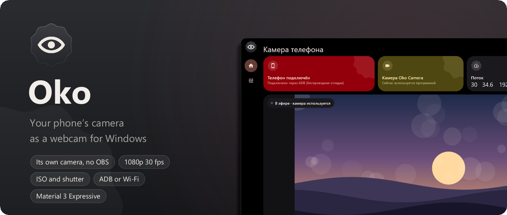
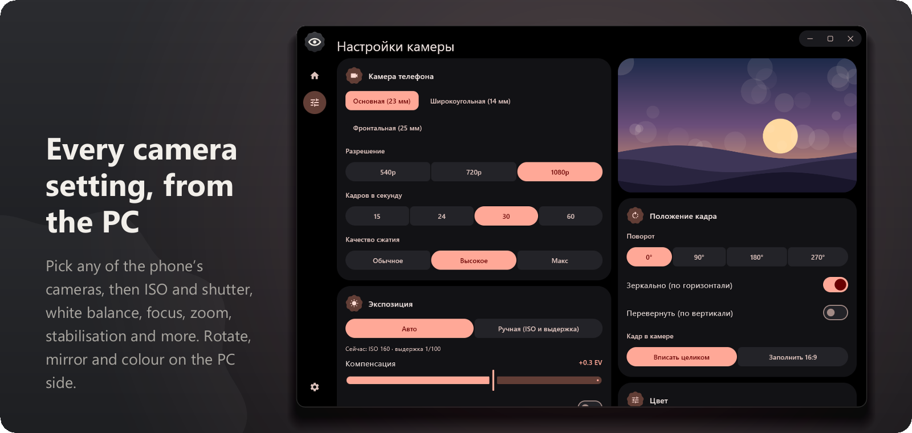

<p align="center"></p>

<p align="center">
  <a href="../../releases/latest"></a>
  
  
  <a href="LICENSE"></a>
</p>

Your Android phone's camera as a webcam for Windows 11. It shows up as a camera of its own, **Oko Camera**, in Discord, Zoom, Teams, the browser and anything else: no OBS, no virtual-camera plugin. Jetpack Compose on the phone, Compose Multiplatform for Desktop on the PC, a small Media Foundation virtual camera in C++ in between. The same Material 3 Expressive look as [Pier.doon](https://github.com/kural3/Pierdoon).

> **Vibe-coded.** Most of this was written by an AI assistant over a chat session and tested on one phone and one PC. Expect bugs and rough edges. Use at your own risk.

## Install

Take the newest files from [Releases](../../releases).

- **Android**: `Oko-<version>.apk`. Android 7.0+.
- **Windows**: `Oko-<version>-Windows.zip`. Windows 11 x64 (the virtual camera API is Windows 11 only). Unpack it and run `Установить.bat` (admin rights: the camera is registered for the whole system). `Удалить.bat` takes it all away again.

Then open Oko on the phone, open Oko on the PC and press «Подключить». In your video call app pick the camera **Oko Camera**.

The interface is in Russian for now.

## Connecting

- **ADB** (recommended). Works over the phone's wireless debugging or a cable, and through a VPN on the phone. The phone app has a step-by-step guide; pairing is done once, from the PC app ("Подключить новый телефон по коду"), no command line. When a cable is plugged in, Oko moves to it by itself.
- **Wi-Fi**. Type in the IP the phone shows. A VPN on the phone blocks this; use ADB then.

## A look around

<p align="center"></p>

## What it does

**The camera**
- A real Windows camera device (Media Foundation virtual camera): 1080p, 720p, 640×480 or 640×360, NV12 or RGB32, a steady 30 fps
- Any of the phone's cameras: main, ultra-wide, telephoto, front ones, named by their focal length
- 540p / 720p / 1080p, 15 to 60 fps, three JPEG qualities
- Exposure: auto with compensation and lock, or manual ISO and shutter; 50/60 Hz anti-flicker
- White balance presets and lock, autofocus or manual focus by distance, zoom from 0.6×
- Torch, video and optical stabilisation, noise reduction, sharpness, colour effects
- The picture turns with the phone: hold it upright for a vertical video

**On the PC**
- Every phone setting above, live, with the values the camera picked itself shown beside them
- Rotate, mirror, flip, "fill 16:9" instead of black bars, brightness, contrast, saturation
- The phone's battery and temperature
- Colours from your wallpaper (or the Windows accent colour); the phone takes its colours from its wallpaper too (Android 12+)

**Easy on the battery**
- With the window minimised and no app using the camera, no video is sent at all and the phone stops encoding. It comes back by itself as soon as an app opens Oko Camera
- Frames are drawn straight into the camera's shared memory, with no copies on the way; the preview is small and only drawn while the window is visible
- The phone dims its screen after 90 s of streaming untouched, stops drawing its own preview then, and switches the camera off when the PC hasn't been watching for 15 s
- The virtual camera doesn't convert a frame again when it hasn't changed

## Where things live on Windows

- The app, the camera DLL and `vcamctl.exe`: `C:\Program Files\Oko`
- Settings: `%APPDATA%\Camera2PC\settings.properties`
- `vcamctl list` lists the cameras Windows sees; `vcamctl test` reads a few frames from Oko Camera

## Build

One Gradle build for both apps. Any JDK starts Gradle; the JDK 25 it builds with is downloaded if missing. The camera DLL is built with [llvm-mingw](https://github.com/mstorsjo/llvm-mingw).

| folder | what |
| --- | --- |
| `phone/` | the Android app: CameraX + Camera2 settings, JPEG encoding on several threads, an MJPEG server with a small control API (`/api/state`, `/api/set?key=value`) on port 8080 |
| `desktop/` | the Windows app: takes the stream, turns and colours the frame, writes it into the camera's shared memory; drives the phone's settings; pairs over adb |
| `driver/` | the virtual camera: a Media Foundation media source DLL loaded by the Frame Server service, and `vcamctl.exe` to install, remove, list and test it |
| `ui/` | Compose code both draw with: the theme (Pier.doon's scheme generator), icons, the logo, expressive pieces. Kotlin Multiplatform (Android + JVM) |
| `installer/` | the install and uninstall scripts |
| `docs/` | the README's pictures and the program that draws them (`Banners.java`) |

```
./gradlew :phone:assembleRelease          # APK
./gradlew :desktop:run                    # start the Windows app
./gradlew :desktop:createDistributable    # the app folder for the installer
sh driver/build.sh                        # Camera2PCCam.dll and vcamctl.exe, in dist/
```

The icon is drawn by `desktop/icons/Icon.java` (every PNG and the .ico); the Android adaptive icon is the same mark in vectors.

## License

[GPL-3.0](LICENSE).
